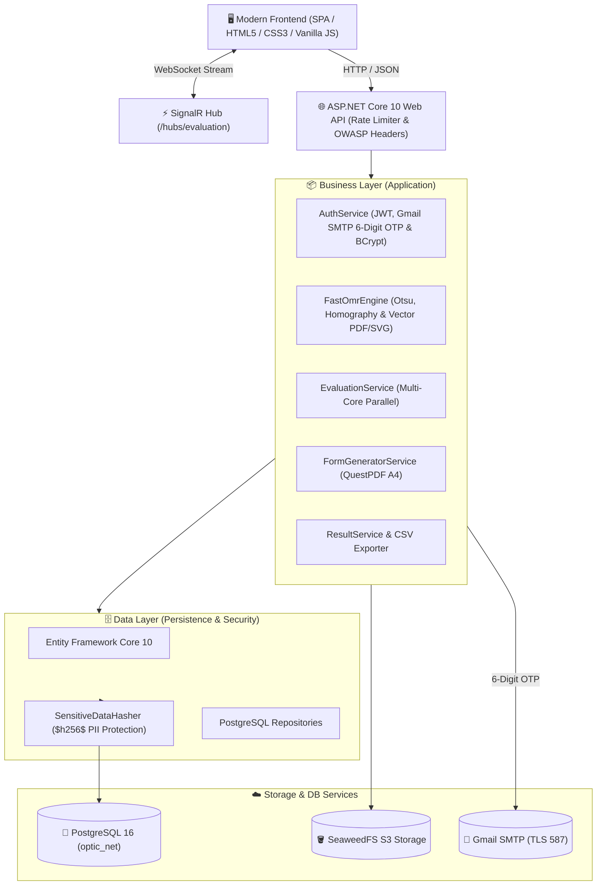

# ⚡ OptiMatrix Enterprise OMR & Sınav Değerlendirme Platformu

<p align="center">
  
  
  
  
  
  
  
  
  
  
</p>

<p align="center">
  <strong>Yüksek Başarımlı, Çok Çekirdekli Paralel Optik İşaret Tanıma (OMR), Vektörel A4 Form Üretimi, 6 Haneli SMTP E-Posta Doğrulaması ve Uçtan Uca Kriptografik Veri Güvenliği Ekosistemi</strong>
</p>

---

## 🎯 Proje Hakkında

**OptiMatrix**, fiziksel ve vektörel optik sınav kağıtlarının taranarak dijital ortama aktarılması, çok çekirdekli paralel işlemcilerle milisaniyeler içerisinde değerlendirilmesi, canlı baloncuk analizlerinin çıkarılması ve ÖSYM standartlarında karnelerin sunulması amacıyla **Clean Architecture** prensipleriyle geliştirilmiş kurumsal bir OMR (Optical Mark Recognition) platformudur.

Harici, hantal veya pahalı fiziksel optik okuyucu cihazlara gerek kalmadan; standart tarayıcılar, cep telefonu kameraları veya çok fonksiyonlu yazıcılardan alınan PDF, SVG, JPG ve PNG görsellerini akıllı görüntü işleme algoritmalarıyla analiz eder.

---

## 🚀 Öne Çıkan Yetenekler & Mimari Özellikler

### 1. ⚡ Çok Çekirdekli Paralel OMR Motoru (`FastOmrEngine`)
* **39 ms Altı İşlem Süresi:** İşlemcinin tüm çekirdeklerini (`Environment.ProcessorCount`) `Parallel.ForEachAsync` ile aynı anda devreye sokar.
* **Otsu Dinamik Eşikleme (Adaptive Thresholding):** Statik parlaklık/kontrast eşiklerine bağımlı kalmadan; kağıdın aydınlatma durumuna, gölgelere veya kağıt kırışıklıklarına göre baloncuk yoğunluğunu piksel matrisi üzerinde dinamik olarak normalize eder.
* **4-Köşe Homografi Perspektif Düzeltme & Vektörel Çözümleme:** Taramadaki açısal eğrilikleri, dönmeleri veya perspektif bozulmalarını homografi matrisi ile düzeltir; ayrıca vektörel PDF ve SVG optik formları deterministik olarak çözümler.
* **Çift İşaretleme & Boş Kontrolü:** Kural dışı çift karalamalar otomatik olarak "Geçersiz / Yanlış", belirlenen doluluk eşiğini aşmayan şıklar ise "Boş" kabul edilir.
* **Kitapçık (A/B/C/D) ve Eksik Cevap Anahtarı Güvenlik Kalkanı:** Optik formda seçili kitapçığın (örn. B Kitapçığı) sisteme girilmiş bir cevap anahtarı bulunmuyorsa, öğrenci yanıtları yanlış sayılmaz; tüm sorular **boş geçilir**, sınav puanı 0.00 yapılarak kağıt **Geçersiz** olarak işaretlenir ve arayüzde kırmızı uyarı panelleriyle bildirilir.

### 2. 📩 Gerçek Gmail SMTP & 6 Haneli OTP E-Posta Doğrulama Sistemi
* **2 Aşamalı Kayıt Ol Akışı:**
  - **1. Aşama:** `Kullanıcı Adı`, `E-Posta Adresi`, `Şifre` ve `Şifre Tekrar` kutuları ile anlık şifre eşleşme kontrolü.
  - **2. Aşama:** Gerçek Gmail SMTP (`smtp.gmail.com:587` TLS) üzerinden gönderilen **6 haneli sayısal doğrulama kodu** ve ortalanmış 6 ayrık kutucuklu OTP arayüzü (yalnızca rakam girişi, otomatik kutu geçişi, `Backspace` navigasyonu, panodan tek tıkla 6 hane yapıştırma, **03:00 canlı geri sayım sayacı** ve **"🔄 Kodu Tekrar Gönder"** desteği).
* **2 Aşamalı Şifremi Unuttum Akışı:**
  - Kayıtlı e-posta adresine gerçek zamanlı **6 haneli şifre sıfırlama kodu** gönderimi, 6 ayrık OTP kutusu ile doğrulama ve `Yeni Şifre` + `Yeni Şifre Tekrar` eşleşme kontrolüyle güvenli şifre güncelleme.

### 3. 🔐 Uçtan Uca Kriptografik Kişisel Veri (PII) Hashleme (`SensitiveDataHasher`)
* **Sıfır Açık Metin (Zero Plaintext PII):** PostgreSQL veritabanındaki tüm kişisel ve kurumsal veriler EF Core `ValueConverter` katmanında deterministik **HMAC-SHA256 + AES-256 (SIV)** algoritmasıyla `$h256$...` formatında, kullanıcı şifreleri ise **BCrypt (`$2a$11$...`)** ile hash'lenerek saklanır:
  - **`Users` Tablosu:** `FullName` (Kullanıcı Adı), `Email`, `PasswordHash`
  - **`StudentSheets` Tablosu:** `StudentNumber` (Öğrenci No), `FirstName`, `LastName`, `TcNo`, `ImageKey`
  - **`UploadBatches` & `ExamTemplates` Tabloları:** `OriginalFileName`, `FileKey`, `InstitutionName`
* Deterministik SIV mimarisi sayesinde veritabanı dökümlerinde hiçbir kişisel veri düz metin olarak okunamazken, e-posta ile indeksli sorgulama (`WHERE "Email" = '$h256$...'`) kayıpsız çalışır.

### 4. 🔒 Kurumsal API Güvenliği & Oturum Yönetimi
* **İlk Açılışta Landing Page -> Güvenli Giriş Akışı:** Uygulama yeni sekmede açıldığında her zaman önce kurumsal **Tanıtım (Landing Page)** ekranını sunar, ardından güvenli **Giriş / Kayıt / Şifremi Unuttum** ekranına yönlendirir.
* **JWT Yetkilendirme & Sliding Expiration:** Sınırlı süreli access token ve süresi dolmadan önce arka planda yenileyen sessiz yenileme (`POST /api/Auth/refresh`) mekanizması.
* **Inactivity Timeout (Hareketsizlik Koruması):** 20 dakika boyunca klavye/fare hareketi olmayan tarayıcı oturumlarını otomatik sonlandırır.
* **Rate Limiting & OWASP Güvenlik Başlıkları:** Brute-force ve DDoS saldırılarına karşı IP bazlı hız sınırlandırma (`FixedWindowLimiter`), `X-Content-Type-Options: nosniff`, `X-Frame-Options: DENY`, `X-XSS-Protection` ve `Referrer-Policy` korumaları.

### 5. 🖨️ QuestPDF ile Vektörel A4 Optik Form Üretimi & Canlı Karne UX
* Piksel bozulması olmayan, baskıya hazır vektörel A4 optik sınav kağıdı üretimi (ÖSYM standartlarında dikey harf kodlamalı Ad-Soyad, 8/11 haneli Öğrenci No, A/B/C/D kitapçık ve çoklu ders sütunları).
* **OpenCV / SkiaSharp Baloncuk Analiz Paneli:** Seçili öğrencinin taranmış optik kağıdı üzerine yeşil (doğru), kırmızı (yanlış/çift) ve gri (boş) baloncuk katmanını gerçek zamanlı çizer ve tek tıkla yazdırılabilir resmi sınav karnesi üretir.

### 6. ☁️ Bulut Tabanlı Dağıtık Altyapı & SeaweedFS S3
* Taranan tüm yüksek çözünürlüklü optik kağıtlar **SeaweedFS S3-uyumlu Object Storage** havuzunda (ve kesintisiz yerel önbellek yedeklemesiyle) güvenle saklanır.
* Veritabanı olarak **PostgreSQL 16**, migration, performans indeksleri ve veri koruma katmanında **Entity Framework Core 10** kullanılır.
* Değerlendirme sürecindeki anlık ilerleme durumu **SignalR WebSocket Hub** üzerinden canlı yüzdelik dilimlerle arayüze aktarılır.

---

## 🏛️ Mimari Tasarım (Clean Architecture)



---

## 📂 Proje Dizin Yapısı

```bash
optic/
├── WebApi/                     # Sunum & Host Katmanı (.NET 10 Web API)
│   ├── Controllers/            # 8 Farklı REST Modülü (Auth, Exam, Template, OMR...)
│   ├── Hubs/                   # SignalR Canlı İlerleme Hub'ı (EvaluationHub)
│   ├── Middleware/             # Performans & İstek Süresi İzleme (PerformanceLogging)
│   ├── wwwroot/                # OptiMatrix Modern Frontend (SPA)
│   │   ├── index.html          # Semantik HTML5 Arayüz (Landing, 6-Digit OTP Auth, App)
│   │   ├── app.js              # State Machine, OTP Sayacı, OMR Canvas, JWT & REST Client
│   │   └── style.css           # Kurumsal CSS3 Tasarım Sistemi (Dark/Light Yüksek Kontrast)
│   └── Program.cs              # DI, Rate Limiting, Otomatik PII Hashleme & Migration
├── business/                   # İş & Algoritma Katmanı
│   ├── Services/               # AuthService, FastOmrEngine, EvaluationService, SheetService...
│   └── business.csproj         # SkiaSharp (Linux Native Assets dahil), QuestPDF, BCrypt
├── core/                       # Çekirdek Alan (Domain) Katmanı
│   ├── Entities/               # User, Exam, ExamTemplate, StudentSheet, ExamResult...
│   ├── DTOs/                   # Register, SendVerificationCode, ForgotPassword, ResetPassword...
│   └── Interfaces/             # Servis ve Repository Arayüzleri
├── data/                       # Veri Erişim & Kriptografi Katmanı (Persistence)
│   ├── Context/                # AppDbContext (PostgreSQL EF Core 10 & PII ValueConverters)
│   ├── Security/               # SensitiveDataHasher ($h256$ HMAC-SHA256 + AES-256 SIV)
│   ├── Storage/                # S3FileStorage (SeaweedFS S3 & Yerel Yedekleme)
│   ├── Migrations/             # Veritabanı Şema & Performans İndeks Geçmişi
│   └── Repositories/           # Veri Erişim Uygulamaları
├── tests/                      # Birim & Yük Testleri
│   ├── OpticEngine.Tests/      # 20 Birim Testi (OMR Motoru, Auth, Cevap Anahtarı, Sonuçlar)
│   └── k6/                     # k6 Yük ve Stres Testi Senaryoları
├── sample_sheets/              # Hazır test optik kağıtları (PDF & JPG - Kemal Sunal, Şener Şen...)
├── docker-compose.yml          # İzole optic_net ağında tek komutla Compose orkestrasyonu
└── Dockerfile                  # Çok aşamalı (multi-stage) Linux üretim imajı
```

---

## 🛠️ Kurulum & Çalıştırma

### Yöntem 1: Docker Compose ile Tek Tıkla Başlatma (Önerilen)

Sistemdeki tüm servisleri (`optic_postgres`, `optic_seaweedfs` ve `optic_web_app`) izole Docker ağı üzerinde tek bir komutla ayağa kaldırabilirsiniz:

```bash
# Proje kök dizininde:
docker compose up -d --build
```

Konteynerler başarıyla başlatıldığında şu adreslerden erişebilirsiniz:
* 🌐 **OptiMatrix Web Uygulaması:** [http://localhost:5144](http://localhost:5144)
* 🩺 **Canlı Sağlık Kontrolü (Health Check):** [http://localhost:5144/health](http://localhost:5144/health)
* 📑 **Swagger API Dokümantasyonu:** [http://localhost:5144/swagger](http://localhost:5144/swagger)
* 🪣 **SeaweedFS S3 Konsolu:** [http://localhost:8333](http://localhost:8333)
* 🐘 **PostgreSQL Veritabanı:** `localhost:5433` (Konteyner içi: `5432`, DB: `opticdb` / Kullanıcı: `postgres`)

---

### Yöntem 2: Yerel (.NET SDK) ile Çalıştırma

Geliştirme ortamınızda doğrudan çalıştırmak için:

1. **Gereksinimler:**
   - [.NET 10 SDK](https://dotnet.microsoft.com/)
   - PostgreSQL 16
   - SeaweedFS / MinIO S3 servisi

2. **Bağımlılıkları Yükleyin ve Derleyin:**
   ```bash
   dotnet restore optic.slnx
   dotnet build optic.slnx
   ```

3. **Veritabanı Migrationlarını Uygulayın:**
   ```bash
   dotnet ef database update --project data --startup-project WebApi
   ```

4. **Uygulamayı Başlatın:**
   ```bash
   dotnet run --project WebApi
   ```

---

## 🧪 Birim & Entegrasyon Testleri (23/23 Başarılı)

OptiMatrix OMR motorunun vektörel/raster okuma doğruluğu, boş/çift işaretleme tespiti, adaptif eşikleme, kimlik doğrulama (`AuthService`), dosya imzası/SVG güvenlik doğrulaması, CSV Formula Injection koruması, PII `$h256$` deterministik şifreleme, cevap anahtarı yönetimi ve puan hesaplama servisleri xUnit ile test edilmektedir:

```bash
dotnet test optic.slnx
```

```text
Toplam 1 test dosyası belirtilen desenle eşleşti.
Başarılı! - Başarısız: 0, Başarılı: 23, Atlanan: 0, Toplam: 23, Süre: 2 s (OpticEngine.Tests.dll)
```

---

## ⚡ Yük, Stres & Performans Testleri (k6 Load Testing)

500+ optik formluk toplu yükleme, paralel değerlendirme ve WebSocket ilerleme takibi için kurumsal SLA gereksinimlerine göre hazırlanmış k6 test senaryoları:

```bash
# k6 ile yük ve stres testini çalıştırma
k6 run tests/k6/omr-batch-load-test.js

# Özel sunucu URL'si veya sınav ID'si ile çalıştırma:
k6 run -e API_URL=http://localhost:5144 -e EXAM_ID=1 tests/k6/omr-batch-load-test.js
```

* **SLA Hedefleri:**
  * %95 İstek Yanıt Süresi ($p_{95}$): `< 1500 ms`
  * Hata Oranı: `< %1.0`
  * Değerlendirme Başarı Oranı: `> %99.0`

---

## 📡 REST API Özeti (Swagger / 36 Uç Nokta)

Platform, kurumsal entegrasyonlar için 8 ana modülde tam **36 adet RESTful uç nokta** sunar:

| Modül | Uç Nokta Sayısı | Açıklama |
|---|---|---|
| **Auth** | 7 | 6 Haneli SMTP Kod Gönderimi (`send-code`), Doğrulamalı Kayıt (`verify-register`), Şifre Sıfırlama Kodu (`forgot-password/send-code`), Şifre Yenileme (`forgot-password/reset`), Giriş (`login`) ve Token Yenileme (`refresh`) |
| **ExamTemplate** | 5 | Şablon CRUD, Çoklu Ders Yapılandırması ve QuestPDF Form Üretimi |
| **Exam** | 5 | Sınav Açma, Güncelleme, Durum Takibi ve Sınav Listesi |
| **AnswerKey** | 4 | A, B, C, D Kitapçıkları için Ders Bazlı Cevap Anahtarı Yönetimi |
| **OpticalSheet** | 5 | SeaweedFS S3'e Kağıt Yükleme, Önizleme ve Süreli İmzalı URL (Presigned URL) |
| **Evaluation** | 3 | Çok Çekirdekli Paralel Değerlendirme Tetikleme ve İlerleme Takibi |
| **Results** | 4 | Sınıf Sıralaması, A4 Öğrenci Karnesi ve Elle Öğretmen Düzeltmesi |
| **Export** | 3 | Excel Uyumlu Dinamik UTF-8 BOM CSV ve Sonuç Dışa Aktarımı |

---

## 📝 Hazır Örnek Test Kağıtları

Sistemi anında test edebilmeniz için `sample_sheets/` dizini altında test senaryolarına uygun hazır doldurulmuş formlar mevcuttur:
* `Ornek_Optik_Form_1_KEMAL_SUNAL_A_Kitapcik.pdf` (Tam Puan / A Kitapçığı)
* `Ornek_Optik_Form_2_SENER_SEN_A_Kitapcik.pdf` (Başarılı / A Kitapçığı)
* `Ornek_Optik_Form_3_ILYAS_SALMAN_B_Kitapcik.pdf` (B Kitapçığı Test Kağıdı)
* `Ornek_Optik_Form_4_HALIT_AKCATEPE_B_Kitapcik.pdf` (B Kitapçığı Test Kağıdı)
* `Ornek_Optik_Form_5_MUNIR_OZKUL_A_Kitapcik.pdf` (Standart / A Kitapçığı)

---

## 👥 Proje Ekibi & Katkıda Bulunanlar (Credits)

<div align="center">

| 💻 Backend & Core Mimari | 🎨 Frontend & UI/UX Geliştirme |
| :---: | :---: |
| **Efe Arda Kaplan** | **Zeynep Yaren Keskin** |
| [](https://github.com/EfeArdaKaplan) | [](https://github.com/zeynepyarenkeskin) |
| *Çekirdek Mimari, Paralel OMR Motoru, Kriptografik Güvenlik & REST API* | *Modern SPA Web Arayüzü, UI/UX Tasarımı & Dashboard* |

</div>

<br>

> 🌟 **Özel Teşekkür:** Modern, responsive, çift temalı (Dark/Light) ve zengin kullanıcı deneyimine (Master-Detail UX, canlı OpenCV tuvali, dinamik A4 karne) sahip kurumsal **Frontend** geliştirmeleri ve değerli katkıları için **[Zeynep Yaren Keskin](https://github.com/zeynepyarenkeskin)**'e (@zeynepyarenkeskin) teşekkür ederiz!

---

## 📄 Lisans

Bu proje [MIT Lisansı](LICENSE) kapsamında açık kaynak olarak paylaşılmıştır.
