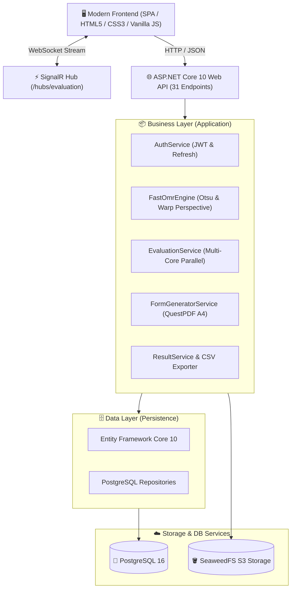

# ⚡ OptiMatrix Enterprise OMR & Sınav Değerlendirme Platformu

<p align="center">
  
  
  
  
  
  
  
  
</p>

<p align="center">
  <strong>Yüksek Başarımlı, Çok Çekirdekli Paralel Optik İşaret Tanıma (OMR), Vektörel A4 Form Üretimi ve Kurumsal Sınav Değerlendirme Ekosistemi</strong>
</p>

---

## 🎯 Proje Hakkında

**OptiMatrix**, fiziksel optik sınav kağıtlarının taranarak dijital ortama aktarılması, çok çekirdekli paralel işlemcilerle milisaniyeler içerisinde değerlendirilmesi, canlı baloncuk analizlerinin çıkarılması ve ÖSYM standartlarında karnelerin sunulması amacıyla **Clean Architecture** prensipleriyle geliştirilmiş kurumsal bir OMR (Optical Mark Recognition) platformudur.

Harici, hantal veya pahalı fiziksel optik okuyucu cihazlara gerek kalmadan; standart tarayıcılar, cep telefonu kameraları veya çok fonksiyonlu yazıcılardan alınan PDF/JPG görsellerini akıllı görüntü işleme algoritmalarıyla analiz eder.

---

## 🚀 Öne Çıkan Yetenekler & Mimari Özellikler

### 1. ⚡ Çok Çekirdekli Paralel OMR Motoru (`FastOmrEngine`)
* **39 ms Altı İşlem Süresi:** İşlemcinin tüm çekirdeklerini (`Environment.ProcessorCount`) `Parallel.ForEachAsync` ile aynı anda devreye sokar.
* **Otsu Dinamik Eşikleme (Adaptive Thresholding):** Statik parlaklık/kontrast eşiklerine bağımlı kalmadan; kağıdın aydınlatma durumuna, gölgelere veya kağıt kırışıklıklarına göre baloncuk yoğunluğunu piksel matrisi üzerinde dinamik olarak normalize eder.
* **4-Köşe Homografi Perspektif Düzeltme:** Taramadaki açısal eğrilikleri, dönmeleri veya perspektif bozulmalarını homografi matrisi ile düzeltir ve baloncuk koordinatlarına milimetrik kilitlenir.
* **Çift İşaretleme & Boş Kontrolü:** Kural dışı çift karalamalar otomatik olarak "Geçersiz / Yanlış", belirlenen doluluk eşiğini aşmayan şıklar ise "Boş" kabul edilir.
* **Kitapçık (A/B/C/D) ve Eksik Cevap Anahtarı Güvenlik Kalkanı:** Optik formda seçili kitapçığın (örn. B Kitapçığı) sisteme girilmiş bir cevap anahtarı bulunmuyorsa, öğrenci yanıtları yanlış sayılmaz; tüm sorular **boş geçilir**, sınav puanı 0.00 yapılarak kağıt **Geçersiz** olarak işaretlenir ve arayüzde kırmızı uyarı panelleriyle bildirilir.

### 2. 🖨️ QuestPDF ile Vektörel A4 Optik Form Üretimi
* Piksel bozulması olmayan, baskıya hazır vektörel A4 optik sınav kağıdı üretimi.
* **ÖSYM Standartlarında Kodlama:**
  - Dikey harf kodlamalı Ad-Soyad matrisi
  - Kurumsal 8/11 haneli Öğrenci No matrisi
  - A/B/C/D Kitapçık seçim alanı
  - Çoklu ders desteği ve 4/5 şıklı esnek soru sütunları

### 3. 📊 Master-Detail Canlı A4 Karne & İnceleme UX
* **Sınıf Sıralaması Tablosu:** Doğru, Yanlış, Boş, Net ve Puan sıralı dinamik sınıf tablosu.
* **Gerçek Öğrenci Bağlantısı:** API'den gelen dinamik öğrenci adı ve öğrenci numarası otomatik bağlanır; hardcoded veriler tamamen kaldırılmıştır.
* **OpenCV / SkiaSharp Baloncuk Analiz Paneli:** Seçili öğrencinin taranmış orijinal görselini arka plana yerleştirip üzerine yeşil (doğru), kırmızı (yanlış/çift) ve gri (boş) baloncuk katmanını gerçek zamanlı çizer.
* **Resmi Sınav Karnesi:** Tek tıkla yazdırılabilir veya PDF olarak kaydedilebilir, ders ders ayrılmış baloncuklu öğrenci karnesi.

### 4. 🔒 Kurumsal Güvenlik & Oturum Yönetimi
* **JWT Yetkilendirme & Sliding Expiration:** Sınırlı süreli access token ve süresi dolmadan önce arka planda yenileyen sessiz yenileme (silent-refresh) mekanizması.
* **Inactivity Timeout (Hareketsizlik Koruması):** 20 dakika boyunca klavye/fare hareketi olmayan tarayıcı oturumlarını otomatik sonlandırır.
* **Loginsiz Başlamama Güvencesi:** Uygulama açılışta doğrudan güvenli Giriş/Kayıt ekranına yönlendirir, kimlik doğrulanmadan iç fonksiyonlara erişim engellenir.

### 5. ☁️ Bulut Tabanlı Dağıtık Altyapı & SeaweedFS S3
* Taranan tüm yüksek çözünürlüklü optik kağıtlar yerel disk yerine **SeaweedFS S3-uyumlu Object Storage** havuzunda güvenle saklanır.
* Veritabanı olarak **PostgreSQL 16**, migration ve repository katmanında **Entity Framework Core 10** kullanılır.
* Değerlendirme sürecindeki anlık ilerleme durumu **SignalR WebSocket Hub** üzerinden canlı yüzdelik dilimlerle arayüze aktarılır.

---

## 🏛️ Mimari Tasarım (Clean Architecture)



---

## 📂 Proje Dizin Yapısı

```bash
optic/
├── WebApi/                     # Sunum & Host Katmanı (.NET 10 Web API)
│   ├── Controllers/            # 8 Farklı REST Modülü (Auth, Exam, Template, OMR...)
│   ├── Hubs/                   # SignalR Canlı İlerleme Hub'ı (EvaluationHub)
│   ├── wwwroot/                # OptiMatrix Modern Frontend (SPA)
│   │   ├── index.html          # Semantik HTML5 Arayüz (Dark/Light Tema)
│   │   ├── app.js              # State Machine, OMR Canvas, JWT & REST Client
│   │   └── style.css           # Kurumsal CSS3 Tasarım Sistemi (Responsive)
│   └── Program.cs              # DI Konfigürasyonu, Swagger ve Middleware
├── business/                   # İş & Algoritma Katmanı
│   ├── Services/               # FastOmrEngine, EvaluationService, FormGeneratorService...
│   └── DependencyInjection.cs  # Business servis kayıtları
├── core/                       # Çekirdek Alan (Domain) Katmanı
│   ├── Entities/               # User, Exam, ExamTemplate, StudentSheet, ExamResult...
│   ├── DTOs/                   # Data Transfer Nesneleri & Yanıt Modelleri
│   └── Interfaces/             # Servis ve Repository Arayüzleri
├── data/                       # Veri Erişim Katmanı (Persistence)
│   ├── Context/                # ApplicationDbContext (PostgreSQL EF Core 10)
│   ├── Migrations/             # Veritabanı Şema Sürüm Geçmişi
│   └── Repositories/           # Generic & Özel Veri Erişim Uygulamaları
├── tests/                      # Birim & Entegrasyon Testleri
│   └── OpticEngine.Tests/      # OMR motoru, baloncuk eşikleme ve kitapçık testleri
├── tools/                      # Geliştirici & Test Araçları
│   └── SampleSheetGenerator/   # Otomatik doldurulmuş A4 optik PDF/JPG test üretici
├── sample_sheets/              # Hazır test optik kağıtları (PDF & JPG - Kemal Sunal, Şener Şen...)
├── docker-compose.yml          # Tek komutla ayağa kaldıran Compose orkestrasyonu
└── Dockerfile                  # Çok aşamalı (multi-stage) üretim imajı
```

---

## 🛠️ Kurulum & Çalıştırma

### Yöntem 1: Docker Compose ile Tek Tıkla Başlatma (Önerilen)

Sistemdeki tüm servisleri (PostgreSQL, SeaweedFS S3 ve OptiMatrix Web API) tek bir komutla ayağa kaldırabilirsiniz:

```bash
# Proje kök dizininde:
docker compose up -d --build
```

Konteynerler başarıyla başlatıldığında şu adreslerden erişebilirsiniz:
* 🌐 **OptiMatrix Web Uygulaması:** [http://localhost:5144](http://localhost:5144)
* 📑 **Swagger API Dokümantasyonu:** [http://localhost:5144/swagger](http://localhost:5144/swagger)
* 🪣 **SeaweedFS S3 Konsolu:** [http://localhost:8333](http://localhost:8333)
* 🐘 **PostgreSQL Veritabanı:** `localhost:5432` (`opticdb` / `postgres`)

---

### Yöntem 2: Yerel (.NET SDK) ile Çalıştırma

Geliştirme ortamınızda Docker kullanmadan doğrudan çalıştırmak için:

1. **Gereksinimler:**
   - [.NET 10 SDK](https://dotnet.microsoft.com/)
   - PostgreSQL (veya Docker üzerinde çalışan `optic_postgres`)
   - SeaweedFS / MinIO S3 servisi

2. **Bağımlılıkları Yükleyin ve Derleyin:**
   ```bash
   dotnet restore
   dotnet build
   ```

3. **Veritabanı Migrationlarını Uygulayın:**
   ```bash
   dotnet ef database update --project data --startup-project WebApi
   ```

4. **Uygulamayı Başlatın:**
   ```bash
   dotnet run --project WebApi
   ```

---

## 🧪 Birim & Entegrasyon Testleri

OptiMatrix OMR motorunun doğruluk, boş/çift işaretleme, adaptif eşikleme ve kitapçık geçersizlik algoritmaları xUnit ile test edilmektedir:

```bash
dotnet test
```

```text
Toplam 1 test dosyası belirtilen desenle eşleşti.
Başarılı! - Başarısız: 0, Başarılı: 6, Atlanan: 0, Toplam: 6, Süre: 835 ms (OpticEngine.Tests.dll)
```

---

## 📡 REST API Özeti (Swagger / 31 Uç Nokta)

Platform, kurumsal entegrasyonlar için 8 ana modülde tam 31 adet RESTful uç nokta sunar:

| Modül | Uç Nokta Sayısı | Açıklama |
|---|---|---|
| **Auth** | 3 | Kullanıcı Kaydı, Giriş ve JWT Token Yenileme (Refresh) |
| **ExamTemplate** | 5 | Şablon CRUD, Çoklu Ders Yapılandırması ve QuestPDF Form Üretimi |
| **Exam** | 5 | Sınav Açma, Güncelleme, Durum Takibi ve Sınav Listesi |
| **AnswerKey** | 4 | A, B, C, D Kitapçıkları için Ders Bazlı Cevap Anahtarı Yönetimi |
| **OpticalSheet** | 4 | SeaweedFS S3'e Tekli/Toplu Kağıt Yükleme ve Önizleme Görüntüsü Alma |
| **Evaluation** | 3 | Çok Çekirdekli Paralel Değerlendirme Tetikleme ve İlerleme Takibi |
| **Results** | 4 | Sınıf Sıralaması, A4 Öğrenci Karnesi ve Elle Öğretmen Düzeltmesi |
| **Export** | 3 | Excel Uyumlu Dinamik UTF-8 BOM CSV ve Sonuç Dışa Aktarımı |

---

## 📝 Hazır Örnek Test Kağıtları

Sistemi anında test edebilmeniz için `sample_sheets/` dizini altında test senaryolarına uygun hazır doldurulmuş formlar mevcuttur:
* `Ornek_Optik_Form_1_KEMAL_SUNAL_A_Kitapcik.pdf` (Tam Puan / A Kitapçığı)
* `Ornek_Optik_Form_2_SENER_SEN_A_Kitapcik.pdf` (Başarılı / A Kitapçığı)
* `Ornek_Optik_Form_3_ILYAS_SALMAN_B_Kitapcik.pdf` (B Kitapçığı Test Kağıdı)
* `Ornek_Optik_Form_4_HALIT_AKCATEPE_B_Kitapcik.pdf` (B Kitapçığı Test Kağıdı)
* `Ornek_Optik_Form_5_MUNIR_OZKUL_A_Kitapcik.pdf` (Standart / A Kitapçığı)

---

## 👨‍💻 Geliştirici & Lisans

* **Geliştirici:** Efe Arda Kaplan ([@EfeArdaKaplan](https://github.com/EfeArdaKaplan))
* **Lisans:** Bu proje [MIT Lisansı](LICENSE) kapsamında açık kaynak olarak paylaşılmıştır.
